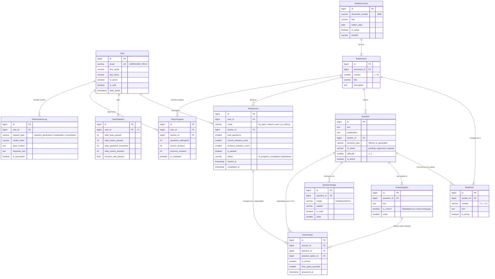

# Архітектура бази даних проекту AI Driving Tutor

## 1. Загальний огляд

У додатку реалізовано модульну монолітну реляційну структуру на базі PostgreSQL 18. Система розділена на 6 незалежних бізнес-додатків Django:
1. `users` — автентифікація, кастомна модель користувача, JWT-сесії.
2. `traffic_rules` — офіційна нормативна база ПДР України (Постанова КМУ № 1306, розділи 1–34, пункти).
3. `questions` — банк питань, варіанти відповідей, прикріплені зображення з валідацією.
4. `testing` — сесії тестування користувачів (за темами, змішані, іспити), фіксація відповідей.
5. `progress` — статистика користувача та відстеження засвоєння тем ПДР.
6. `ai_tutor` — журнал запитів та генерацій Gemini AI, захист від галюцинацій та моніторинг токенів.

---

## 2. Повна ER-діаграма системи

---

## 3. Критичні архітектурні принципи

1. **Ізоляція підрахунку балів від ШІ:** Правильність кожної відповіді (`AnswerOption.is_correct` та `UserAnswer.is_correct`) встановлюється виключно Django-сервером через транзакційні порівняння в PostgreSQL. Модель Gemini не має доступу до зміни балів.
2. **Захист від галюцинацій у ПДР:** Будь-яка генерація пояснень або адаптивних запитань отримує виключно верифікований контекст конкретних пунктів `RulePoint` із PostgreSQL.
3. **Модерація згенерованих питань:** Питання, створені ШІ (`ai_generated`), отримують статус `pending` і можуть використовуватись лише у режимі тренування або після верифікації адміністратором.
